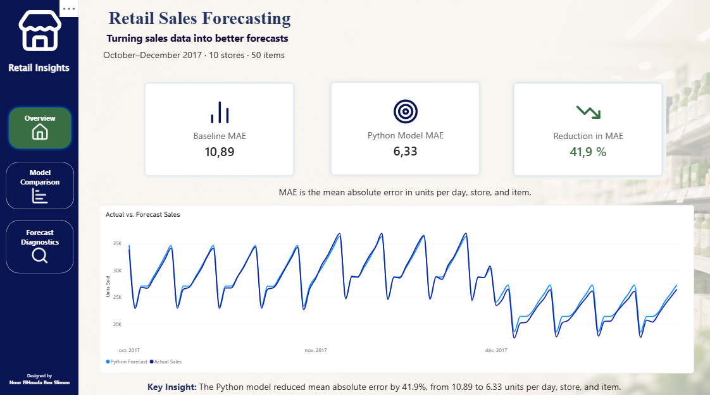
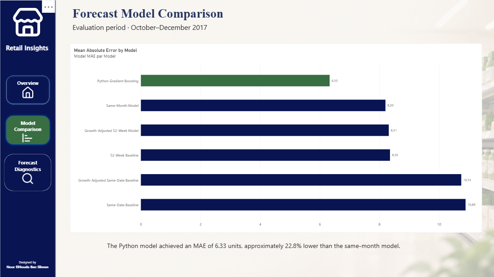
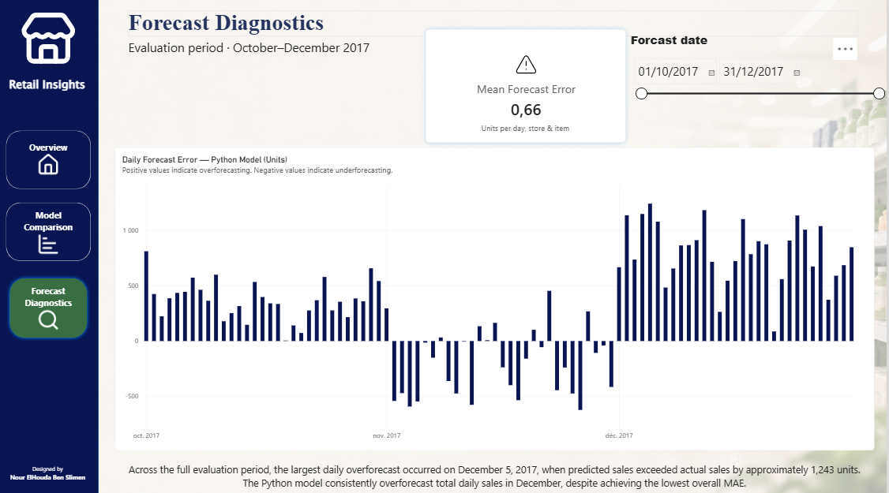

# Retail Sales Forecasting
### Python · Power BI · Demand Forecasting

Forecasting daily sales across 10 stores and 50 items, with an interactive Power BI report comparing seasonal baselines and a gradient boosting model.

The Python model achieved an MAE of **6.33 units**, approximately **41.9% lower than the initial baseline** and **22.8% lower than the same-month model** on the October–December 2017 evaluation period.

## Business Objective

Estimate demand three months ahead at the store–item level to support inventory planning. Compare forecasting methods and identify periods of systematic overforecasting or underforecasting.

## Dataset

Source — Kaggle, Store Item Demand Forecasting Challenge.

The project uses the competition's historical `train.csv` file.

- 913,000 observations
- January 2013 through December 2017
- 10 stores and 50 items
- 500 store–item combinations
- Daily sales ranging from 0 to 231 units
- No missing values or duplicate date–store–item combinations

The historical data was divided chronologically.

| Dataset | Period | Observations |
|---|---|---:|
| Training | January 2013 – September 2017 | 867,000 |
| Evaluation | October – December 2017 | 46,000 |

The evaluation period was held out from Python model training.

## Methodology

1. Validate data quality and create a chronological split.
2. Explore sales trends and seasonality in Power BI.
3. Build seasonal reference forecasts and growth adjustments.
4. Compare a 52-week reference with a method that keeps historical reference dates within the forecast month.
5. Train a Python gradient boosting model using store, item and calendar features.
6. Export forecasts and errors to Power BI for comparison and diagnostics.

### Python Model

The notebook uses scikit-learn's `HistGradientBoostingRegressor`.

Input features include store, item, year, month, day of week, day of month and the number of days since January 1, 2013.

The model uses 200 boosting iterations, a learning rate of 0.1 and up to 31 leaves per tree. Negative predictions are clipped to zero.

## Model Comparison

All MAE values are calculated at the daily store–item level over October–December 2017.

| Model | MAE |
|---|---:|
| Same-Date Baseline | 10.89 |
| Growth-Adjusted Same-Date Baseline | 10.74 |
| 52-Week Baseline | 8.35 |
| Growth-Adjusted 52-Week Model | 8.31 |
| Same-Month Model | 8.20 |
| **Python Gradient Boosting** | **6.33** |

Percentage improvements are approximate because the displayed MAE values are rounded.

## Error Interpretation

- **MAE** measures the average absolute error in units per day, store and item.
- **Mean Error** is the average forecast minus actual sales. Positive values indicate overforecasting.
- **Daily Forecast Error** sums signed errors across all stores and items for each date.

The Python model's Mean Error is **+0.66 units** per day, store and item.

## Power BI Report

### Overview

Baseline and Python model MAE, percentage improvement, and actual versus predicted daily sales.

### Model Comparison

Six forecasting approaches ranked by MAE.

### Forecast Diagnostics

Daily signed forecast errors, average bias and an interactive date filter.

## Findings and Limitations

The Python model achieved the lowest overall MAE among the six approaches evaluated.

Daily totals show persistent overforecasting in December. The largest daily overforecast occurred on December 5, 2017, at approximately **1,243 units**.

Errors across stores and items can offset one another in daily totals. The daily diagnostic chart therefore complements the store–item MAE.

Results cover one historical three-month evaluation period. Additional chronological backtests would help assess performance across other periods before operational use.

## Repository Files

| File | Purpose |
|---|---|
| [Python notebook](Retail_Sales_Forecastingipynb.ipynb) | Data checks, features, model training and evaluation |
| [Power BI report](Project_Retail_Forecasting.pbix) | Interactive report and seasonal baselines |
| [Forecast results](Forecast_Evaluation_Python.csv) | 46,000 forecasts with actual sales and errors |
| Overview.png | Overview screenshot |
| Model_Comparison.png | Model comparison screenshot |
| Forcasting_Diagnostics.png | Diagnostics screenshot |

## Run the Project

1. Download the historical `train.csv` from the Kaggle competition.
2. Open the notebook in Google Colab.
3. Run the upload cell and select `train.csv`.
4. Execute the remaining cells in order.
5. Download the generated `Forecast_Evaluation_Python.csv`.
6. Open the Power BI report in Power BI Desktop.
7. Update local source paths in Power Query before refreshing.

The notebook uses pandas and scikit-learn.

## Author

**Nour El Houda Ben Slimen**

Business Intelligence · Data Analysis · Forecasting
